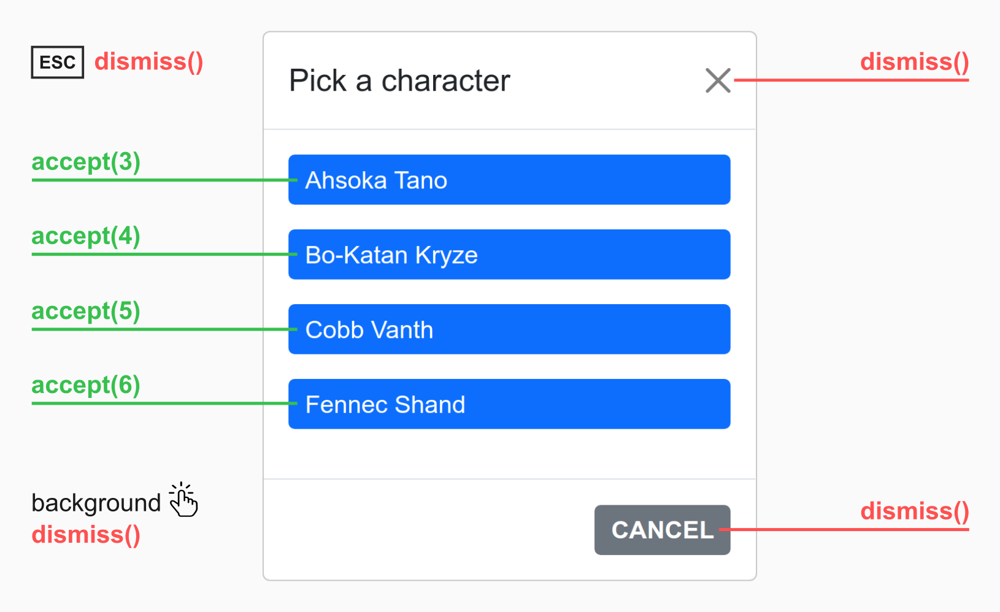

Closing overlays
================

An overlay closes when the user is done with it. The user can dismiss it with the `Escape` key
or the `×` button, and the overlay's own content can close it from a button, a link, a form,
JavaScript or a server response.
When it closes, the overlay can pass a result value back to the layer that opened it,
so the original screen can continue where the user left off.


Accepting and dismissing {#intents}
------------------------

Unpoly distinguishes two intents when an overlay closes:

1. **Accepting** an overlay: the user picked a value, confirmed with *OK*, or completed their task.
   An overlay can be accepted with a value.
2. **Dismissing** an overlay: the user clicked *Cancel* or the `×` button, pressed `Escape`,
   or clicked on the background.

{:width='600'}

Acceptance usually continues a larger interaction in the parent layer, like
[selecting a record that was just created](/subinteractions).
Dismissal usually means cancellation. When you wait for a subtask to finish,
you are interested in acceptance, but not in dismissal.

When an overlay closes, overlays it has opened are closed with it, its pending requests are
[aborted](/aborting-requests#layers), and [focus returns](/focus#overlays) to the link that opened it.


Result values {#result-values}
-------------

An overlay can close with a *result value*. The value is passed to the layer that
opened the overlay, which can use it to continue its own interaction:
[select a new option](/subinteractions#adding-options-to-an-existing-select),
[navigate to another screen](/subinteractions#navigating-away), or reload a list.
See [[subinteractions#result-values]] for how the opener receives the value.

### Acceptance values {#acceptance-values}

When the user selects a value, creates a record or confirms an action,
the overlay is *accepted with that value*. The sections below show how a
[button](#on-click), a [form](#on-submit), [JavaScript](#from-script) or the [server](#from-server)
pass a value when closing.

In the opener's `[up-on-accepted]` attribute, the value is available as `value`:

```html
<a href="/select-user"
  up-layer="new"
  up-on-accepted="console.log('Got user', value)"> <!-- mark: value -->
  Select user
</a>
```

### Dismissal reasons {#dismissal-reasons}

When an overlay is dismissed, the result value indicates the reason for dismissal.
For instance, clicking the `×` button dismisses with the value `":button"`.

<a id="customizing-dismiss-controls"></a>
<a id="customizing-the-dismiss-icon"></a>

The [standard dismiss controls](/customizing-overlays#customizing-dismiss-controls) set these reasons:

| User interaction                                    | Dismissal reason |
|-----------------------------------------------------|------------------|
| User presses the `Escape` key                       | `":key"`         |
| User clicks on the background ("light dismiss")     | `":outside"`     |
| User clicks on the `×` button in the overlay corner | `":button"`      |

An overlay that closes because a layer below it is [updated](#peeling) is dismissed with `":peel"`.
You can provide your own dismissal reason when closing an overlay with `up.layer.dismiss()` or `[up-dismiss]`.

The opener receives the reason in an `{ onDismissed }` callback or `[up-on-dismissed]` attribute:

```html
<a href="/select-user"
  up-layer="new"
  up-on-dismissed="console.log('Dismissed because of', value)"> <!-- mark: value -->
  Select user
</a>
```


Letting the opener decide {#close-conditions}
-------------------------

<a id="location-condition"></a>
<a id="event-condition"></a>
<a id="fragment-condition"></a>

Instead of closing the overlay from its content, the link that opens it can define a
*close condition*, like reaching a URL. The overlay then closes automatically when its task is done.
We recommend close conditions over the explicit commands on this page, since the
overlay content then does not need to know that it is running in an overlay.
See [[subinteractions#close-conditions]].


Closing when a button is clicked {#on-click}
--------------------------------

To close the [current layer](/up.layer.current) when a button is clicked, set an `[up-accept]` or `[up-dismiss]` attribute:

```html
<button up-accept>Close overlay</button> <!-- mark: up-accept -->
```

To close with a [result value](#result-values), set the attribute to a [relaxed JSON](/relaxed-json) value:

```html
<button up-accept="{ id: 5 }">Choose user #5</button> <!-- mark: { id: 5 } -->
```


Closing when a link is followed {#on-follow}
-------------------------------

When [reusing a page within an overlay](/subinteractions#reusing-existing-screens),
you may want a link that closes the overlay, but navigates somewhere else when clicked on the root layer.

For this, set `[up-accept]` or `[up-dismiss]` on a hyperlink (`<a>`) with a fallback URL in its `[href]` attribute:

```html
<a href="/list" up-accept>Finish</a> <!-- mark: href="/list" -->
```

Clicked in an overlay, the link accepts the overlay and the `click` event is prevented.
Clicked on the [root layer](/up.layer.root), the link navigates to `/list`.


Closing when a form is submitted {#on-submit}
--------------------------------

To close an overlay when a form is submitted, set an `[up-accept]` or `[up-dismiss]` attribute on the `<form>` element.
The overlay closes immediately on submission, without a network request:

```html
<form up-accept> <!-- mark: up-accept -->
  ...
</form>
```

### Accessing the form params

The form's field values become the [result value](#result-values) of the closed overlay.

For example, this form has two fields named `foo` and `bar`:

```html
<form up-accept>
  <input name="foo" value="1"> <!-- mark: foo -->
  <input name="bar" value="2"> <!-- mark: bar -->
</form>
```

The params are exactly those a [regular submission](/up.Params.fromForm) would send, so a
[submit button](/up.Params.fromForm#submit-button) with a `[name]` also contributes its value.
This lets the opener see *which* button was pressed:

```html
<form up-accept>
  <button type="submit" name="commit" value="save">Save</button> <!-- mark: commit -->
  <button type="submit" name="commit" value="publish">Publish</button>
</form>
```

The values arrive as an `up.Params` object in the opener's `{ onAccepted }` or `{ onDismissed }` callback:

```js
up.layer.open({
  url: '/form',
  onAccepted: ({ value }) => {
    console.log(value.get('foo')) // result: "1"
    console.log(value.get('bar')) // result: "2"
  }
})
```

### Regular submission on the root layer

When a form with `[up-accept]` or `[up-dismiss]` is submitted within an overlay, the `submit` event
is prevented and no request is made.

When the same form is submitted on the root layer, there is no overlay to close.
The form is then submitted regularly, e.g. with a `POST` request.
This lets you [reuse an existing form within an overlay](/subinteractions#reusing-existing-screens).

### Closing after the submission request

When the form should make its request *before* the overlay closes, do *not* set
an `[up-accept]` or `[up-dismiss]` attribute. Make a regular form that is handled by Unpoly instead:

```html
<form up-submit> <!-- mark: up-submit -->
  ...
</form>
```

After the server has processed the request, it can close the overlay in several ways:

- Redirecting to a [location that is a close condition](/subinteractions#location-condition)
- Emitting an [event that is a close condition](/subinteractions#event-condition)
- Sending a [response header that closes the overlay](#from-server)


Closing from JavaScript {#from-script}
-----------------------

When you cannot use a [close condition](#close-conditions), call `up.layer.accept()`
to accept the [current layer](/up.layer.current):

```js
up.layer.accept()
```

To accept with a [result value](#result-values), pass it as an argument:

```js
up.layer.accept({ name: 'Anna', email: 'anna@domain.tld' })
```

To *dismiss* an overlay from JavaScript, use `up.layer.dismiss()` in the same fashion.


Closing from the server {#from-server}
-----------------------

When you cannot use a [close condition](#close-conditions),
the server can close the targeted overlay by sending an `X-Up-Accept-Layer` or `X-Up-Dismiss-Layer` response header.
The header value is the [result value](#result-values) as [relaxed JSON](/relaxed-json), or `null` for no value:

```http
Content-Type: text/html
X-Up-Accept-Layer: { id: 123 }

<html>
  ...
</html>
```

With the `unpoly-rails` gem, you can produce these headers with `up.layer.accept(value)` or `up.layer.dismiss(value)`.
Libraries for other backends offer similar helpers, or you can set the headers yourself.

The server can check whether a request targets an overlay by looking at the `X-Up-Mode` request header.

When an overlay closes in reaction to a server response, you can [access the discarded response](#using-the-discarded-response).


Keeping an overlay open {#keeping-open}
-----------------------

<a id="callbacks"></a>

To keep an overlay open, for example when it has unsaved changes, prevent its
[`up:layer:dismiss`](/up:layer:dismiss) event. This also blocks the Escape key, backdrop clicks
and the close button:

```js
up.on('up:layer:dismiss', function(event) {
  let hasForm = event.layer.element.querySelector('form')
  if (hasForm && !confirm('Discard your unsaved changes?')) {
    event.preventDefault() // mark-line
  }
})
```

To keep only one particular overlay open, set an [`[up-on-dismiss]`](/up-layer-new#up-on-dismiss) attribute
on the opening link, or pass an [`{ onDismiss }`](/up.layer.open#options.onDismiss) callback, and call `event.preventDefault()` in it.
Mind the tense: `[up-on-dismiss]` runs *before* the overlay closes,
<code>[up-on-dismiss<b>ed</b>]</code> (past tense) runs *after* it closed.

No listener can keep an overlay open when the user presses the Back button, since
[going back](/history-in-overlays#restoration) closes all overlays.

When an overlay closes because a layer below it is [updated](#peeling), `event.value` is `":peel"`,
so a listener can treat that case differently.


Closing by targeting a background layer {#peeling}
---------------------------------------

When a link or form in an overlay targets a background layer, the overlay
is [dismissed](#intents) once the background layer is updated. This behavior is called *peeling*.

The form below uses an [`[up-layer]`](/targeting-other-layers) attribute to update the parent layer
after a successful submission:

```html
<form method="post" action="/users" up-layer="parent"> <!-- mark: up-layer="parent" -->
  <input type="text" name="email">
  <button type="submit">Create user</button>
</form>
```

A successful submission dismisses the form's own overlay with a [dismissal reason](#dismissal-reasons) of `":peel"`.

If a listener [keeps the overlay open](#keeping-open), the background layer is not updated.
To close the overlay anyway, set an `[up-peel="force"]` attribute.

> [note]
> The form still updates its own layer when the [server responds with an error code](/failed-responses)
> due to a validation error.\
> To update another layer in this case, set an [`[up-fail-layer]`](/up-follow#up-fail-layer) attribute.


### Accepting peeled overlays

By default, peeled overlays are [dismissed](#intents). To [accept](#intents) them instead, set an `[up-peel="accept"]` attribute
on the link or form that targets the background layer:

```html
<form method="post" action="/users" up-layer="parent" up-peel="accept"> <!-- mark: up-peel="accept" -->
  ...
</form>
```


Discarded responses {#discarded-responses}
-------------------

When a server response closes an overlay, nothing from that response is rendered.
This happens when the response matches a [close condition](/subinteractions#close-conditions),
or when the server [explicitly closes](#from-server) the overlay.

### Using the discarded response {#using-the-discarded-response}

Sometimes you need the discarded response anyway, e.g. to render its content in another layer.

One way is an `[up-hungry]` element with an `[up-if-layer=subtree]` attribute in a parent layer.
Such an element is updated with the discarded response of a closing overlay.

For more control, read the response from the `{ response }` property of the `up:layer:accepted`
and `up:layer:dismissed` events, and pass it to `up.render()`.
See [[subinteractions#reloading-on-acceptance]] for an example that updates a list
without making another request.

The `{ response }` property is set whenever a server response causes an overlay to close:

- When a [server-sent event](/X-Up-Events) matches a [close condition](/subinteractions#close-conditions).
- When the new location matches a [close condition](/subinteractions#close-conditions).
- When the server [explicitly closes](#from-server) an overlay with an HTTP header.


### Rendering discarded notification flashes {#rendering-discarded-notification-flashes}

[Confirmation flashes](/flashes) in a discarded response would be lost as well.

An `[up-flashes]` element picks up flashes from a closing overlay and
[renders them into the parent layer](/flashes#from-closing-overlays).


Close animation
---------------

To close with a different animation than the one configured for the overlay, pass an `{ animation }`
option to `up.layer.accept()` or `up.layer.dismiss()`, or set an `[up-animation]` attribute on an
`[up-accept]` or `[up-dismiss]` element. See [[customizing-overlays#animation]] for the default animations.


@page closing-overlays
@signature
