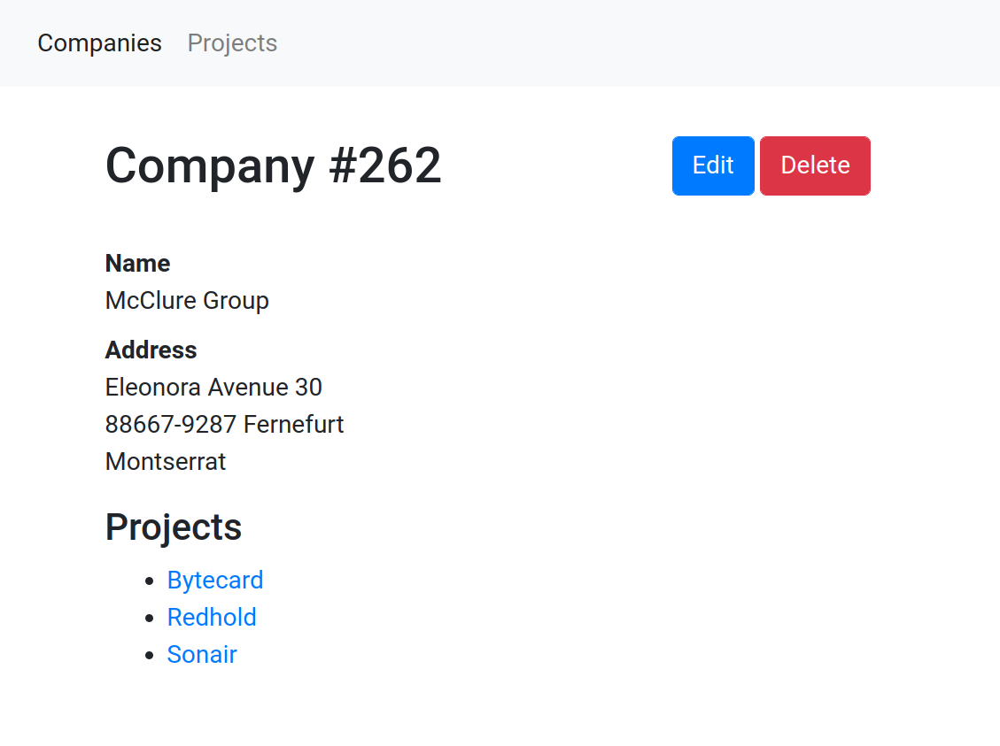
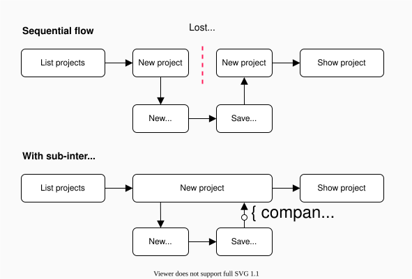

Subinteractions
===============

A subinteraction is a task the user completes in an overlay, while the original screen
stays open behind it. When the task is done, the overlay closes and passes a result value
back to the original screen, which continues where the user left off. The overlay
can show any existing screen of your app, without that screen knowing it is embedded.


Example
-------

Imagine an application that manages *projects* and *companies*:

- Each project is associated with a company.
- Each company may have multiple projects.
- The application has [CRUD interfaces](https://en.wikipedia.org/wiki/CRUD) for projects and companies.

<figure>
  
  <figcaption>

The page for a company shows its name and address, Edit and Delete buttons, and a list of the company's projects.
A navigation bar links to the lists of all companies and all projects.

  </figcaption>
</figure>

With a sequential screen flow, a missing company breaks the user's work:

- The user starts filling in the form for a new project.
- To create a project, the user must select a company. But the desired company does not exist yet.
- The user must abandon the half-completed project form to create the missing company.
  **All entered project data is lost.**
- After creating the company, the user returns to the project form
  and enters the lost data again.

With a *subinteraction*, the project form stays open:

- The user starts filling in the form for a new project.
- To create a project, the user must select a company. But the desired company does not exist yet.
- The user opens an overlay to create the missing company.\
  **The unfinished project form remains open in the background.**
- When the company is created in the overlay, the overlay closes.\
  The project form now has the new company selected.

The diagram shows the difference between the two control flows:

<figure>
  
  <figcaption>

Both flows go from "List projects" to "New project" and end at "Show project".

In the sequential flow, the user leaves "New project" for "New company" and "Save company",
then arrives at a second "New project" screen. The state of the first project form is lost between the two.

With a subinteraction, there is only one "New project" screen. "New company" and "Save company" happen
while it stays open, and saving the company passes `{ companyID: 3 }` back to the project form.

  </figcaption>
</figure>


Starting a subinteraction
-------------------------

To start a subinteraction, open an overlay with a [close condition](#close-conditions)
and an acceptance callback:

```html
<a href="/companies/new"
  up-layer="new"
  up-accept-location="/companies/$id"
  up-on-accepted="up.reload('.company-list')"> <!-- mark: up-on-accepted -->
  New company
</a>

<div class="company-list">
  ...
</div>
```

Once the company is created, the server redirects to its URL, like `/companies/123`.
The overlay is accepted automatically, and the callback reloads the list behind the overlay.

The overlay can show any screen of your app. It takes no part in ending the subinteraction:
the link that opened the overlay defines when the task is done, and what happens then.


Close conditions {#close-conditions}
----------------

When opening an overlay, you can define a *condition* for when the overlay's task is done.
When the condition occurs, the overlay closes automatically and your callback runs.

We recommend close conditions over explicit commands like [`up.layer.accept()`](/learn/closing-overlays#from-script)
or [`X-Up-Accept-Layer`](/learn/closing-overlays#from-server). With a close condition, the overlay content does not need
to know that it is running in an overlay. The same screen works as a full page and as
a step of another screen's interaction.


### Closing when a location is reached {#location-condition data-toc-include}

To close an overlay once it reaches a URL like `/companies/123`, set an [`[up-accept-location]`](/api/up-layer-new#up-accept-location)
attribute with a [URL pattern](/api/url-patterns):

```html
<a href="/companies/new"
  up-layer="new"
  up-accept-location="/companies/$id"
  up-on-accepted="alert('New company with ID ' + value.id)"> <!-- mark: up-accept-location="/companies/$id" -->
  New company
</a>
```

When the user submits the company form and the server redirects to `/companies/123`,
the overlay is accepted. Named segments captured by the [URL pattern](/api/url-patterns) (`$id`) become
the overlay's [acceptance value](#result-values), along with the matched `location`:
here `{ id: 123, location: '/companies/123' }`.

The condition is checked whenever the overlay's location changes. When the form fails validation,
the server re-renders it without changing the location, so the overlay stays open until the
submission succeeds.

A `$id` segment only matches digits, so the overlay's own URL `/companies/new` does not match the pattern.

To *dismiss* an overlay once a location is reached, use `[up-dismiss-location]` and `[up-on-dismissed]` in the same fashion.


### Closing when an event is emitted {#event-condition data-toc-include}

To close an overlay once an event is observed within it, set an [`[up-accept-event]`](/api/up-layer-new#up-accept-event) attribute:

```html
<a href="/companies/new"
  up-layer="new"
  up-accept-event="company:created"
  up-on-accepted="alert('New company with ID ' + value.id)"> <!-- mark: up-accept-event="company:created" -->
  New company
</a>
```

When a `company:created` event is emitted within the overlay, the event's
[default action is prevented](https://developer.mozilla.org/en-US/docs/Web/API/Event/preventDefault) and the overlay is accepted.
The event object becomes the overlay's [acceptance value](#result-values).

To *dismiss* an overlay once an event is observed, use `[up-dismiss-event]` and `[up-on-dismissed]` in the same fashion.

There are several ways to emit an event:

| Method            | Description             |
|-------------------|-------------------------|
| `up.emit()`       | JavaScript function to emit an event on any element |
| `up.layer.emit()` | JavaScript function to emit an event on the [current layer](/api/up.layer.current) |
| `[up-emit]`       | HTML attribute to emit an event on click |
| `X-Up-Events`     | HTTP header sent from the server |
| [`Element#dispatchEvent()`](https://developer.mozilla.org/en-US/docs/Web/API/EventTarget/dispatchEvent) | Standard DOM API to emit an event on an element |

Since the closing event's default is prevented, an `[up-emit]` link with a [fallback URL](/api/up-emit#fallback)
can close an overlay, but navigate to a different page when clicked on the [root layer](/api/up.layer.root).


### Closing when a fragment is detected {#fragment-condition data-toc-include}

To close an overlay once an element matching a selector appears within it,
set an [`[up-accept-fragment]`](/api/up-layer-new#up-accept-fragment) attribute:

```html
<a href="/companies/new"
  up-layer="new"
  up-accept-fragment=".company-profile"
  up-on-accepted="alert('New company with ID ' + value.id)"> <!-- mark: up-accept-fragment=".company-profile" -->
  New company
</a>
```

When an element in the overlay matches `.company-profile`, the overlay is accepted.
The fragment's [data](/learn/data) becomes the [acceptance value](#result-values):

```html
<div class="company-profile" data-id="123"> <!-- mark: data-id="123" -->
  ...
</div>
```

If the fragment has no data, the acceptance value is an empty object (`{}`).

To *dismiss* an overlay once a fragment is detected, use `[up-dismiss-fragment]` and `[up-on-dismissed]` in the same fashion.


Running code when an overlay closes {#callbacks}
-----------------------------------

When opening an overlay, you can pass separate `{ onAccepted }` and `{ onDismissed }` callbacks
for [accepting and dismissing](/learn/closing-overlays#intents):

```js
up.layer.open({
  url: '/companies/new',
  acceptLocation: '/companies/$id',
  onAccepted: (event) => console.log('Company was created'), // mark: onAccepted
  onDismissed: (event) => console.log('Company creation was canceled') // mark: onDismissed
})
```

Both callbacks are optional.

In HTML, set `[up-on-accepted]` and `[up-on-dismissed]` attributes on the link that opens the overlay:

```html
<a href="/companies/new"
  up-layer="new"
  up-accept-location="/companies/$id"
  up-on-accepted="console.log('Company was created')"
  up-on-dismissed="console.log('Company creation was canceled')"> <!-- mark: up-on-dismissed -->
  New company
</a>
```

These callbacks run after the overlay has closed. To keep an overlay open instead,
see [[closing-overlays#keeping-open]].

Instead of passing callbacks, you can also open an overlay with `up.layer.ask()`
and `await` a promise for its result. See [awaiting subinteractions](#awaiting-subinteractions-from-javascript).


Working with result values {#result-values}
--------------------------

When an overlay is accepted, it passes a *result value* to the layer that opened it,
called the *acceptance value*.
Where the value comes from depends on how the overlay was closed:

| Overlay is accepted by                                                        | Acceptance value                                  |
|-------------------------------------------------------------------------------|---------------------------------------------------|
| Reaching a [location](#location-condition) like `/companies/$id`              | The captured segments and the `location`, e.g. `{ id: 123, location: '/companies/123' }` |
| An [event](#event-condition) like `company:created`                           | The event object                                  |
| A [fragment](#fragment-condition) like `.company-profile`                     | The fragment's [data](/learn/data)                      |
| A button with [`[up-accept="{ id: 123 }"]`](/learn/closing-overlays#on-click)       | The attribute's [relaxed JSON](/api/relaxed-json) value |
| A form with [`[up-accept]`](/learn/closing-overlays#on-submit)                      | The form's params as an `up.Params` object        |
| A script calling [`up.layer.accept(value)`](/learn/closing-overlays#from-script)    | The `value` argument                              |
| An [`X-Up-Accept-Layer`](/learn/closing-overlays#from-server) response header       | The header's [relaxed JSON](/api/relaxed-json) value  |

In an `[up-on-accepted]` attribute, the value is available as `value`:

```html
<a href="/companies/new"
  up-layer="new"
  up-accept-location="/companies/$id"
  up-on-accepted="console.log('Company ID is', value.id)"> <!-- mark: value.id -->
  New company
</a>
```

An `{ onAccepted }` callback receives it as `event.value`:

```js
up.layer.open({
  url: '/companies/new',
  acceptLocation: '/companies/$id',
  onAccepted: (event) => console.log('Company ID is', event.value.id) // mark: event.value.id
})
```

When the user cancels the subinteraction, the overlay is *dismissed* instead.
Dismissal also carries a [dismissal value](/learn/closing-overlays#dismissal-values), like `":key"` when the user pressed `Escape`.
A subinteraction is usually interested in acceptance only.


Common acceptance callbacks
---------------------------

### Reloading on acceptance {#reloading-on-acceptance}

The most common callback reloads an element in the parent layer with `up.reload()`,
as in the [example above](#starting-a-subinteraction).

To only reload an element, you can also set `[up-on-accepted-reload]` to its selector.
It runs no JavaScript, so it also works under a strict [Content Security Policy](/learn/script-security) without a nonce:

```html
<a href="/companies/new"
  up-layer="new"
  up-accept-location="/companies/$id"
  up-on-accepted-reload=".company-list"> <!-- mark: up-on-accepted-reload -->
  New company
</a>
```

Unpoly looks for the element in the layer that opened the overlay, and prefers an element near the link.
When the link also has an `[up-on-accepted]` callback, the callback runs first.
To reload after the overlay was dismissed, use `[up-on-dismissed-reload]`.
An overlay with nothing to confirm, like a list where the user adds and removes items, is only ever dismissed.
See [[closing-overlays#intents]].

Sometimes the response that accepted the overlay already contains the HTML to update
the element. In that case, render `event.response` instead of making another request:

```html
<a href="/companies/new"
  up-layer="new"
  up-accept-location="/companies"
  up-on-accepted="up.render('.company-list', { response: event.response })"> <!-- mark: { response: event.response } -->
  New company
</a>
```

See [[closing-overlays#using-the-discarded-response]].


### Adding options to an existing select

Another common callback reloads the options of a `<select>` and selects the new record:

```html
<fieldset>
  <label for="company">Company</label>
  <select id="company" name="company">...</select>
</fieldset>

<a href="/companies/new"
  up-layer="new"
  up-accept-location="/companies/$id"
  up-on-accepted="up.validate('select', { params: { company: value.id } })"> <!-- mark-line -->
  New company
</a>
```

This uses `up.validate()` to re-render the select's [form group](/api/up-form-group) from the server,
as if the user had already picked the new company. The form is not saved by this.


### Navigating away

You may also want to navigate to a new screen once the overlay was accepted:

```html
<a href="/companies/new"
  up-layer="new"
  up-accept-location="/companies/$id"
  up-on-accepted="up.navigate({ url: '/projects/new?company_id=' + value.id })"> <!-- mark-line -->
  New company
</a>
```


Reusing existing screens
------------------------

The company form in the examples above is the regular form from your companies CRUD.
It has no idea that it is sometimes opened from a project form, and it needs no changes for this.
The link that opens the overlay carries the acceptance condition and the callback,
so the same form works on its own, in an overlay, and in a new tab.

This works because [layers are isolated](/learn/overlays#layers-are-isolated): the form in the overlay
re-renders within that overlay, even when the project form behind it has elements with the same selectors.

Some screens have an element that should close the overlay, but still make sense on a full page.
A *Finish* link can [close the overlay when followed](/learn/closing-overlays#on-follow), and navigate
to its `[href]` when clicked on the root layer:

```html
<a href="/companies" up-accept>Finish</a> <!-- mark: up-accept -->
```

A form with an `[up-accept]` attribute closes the overlay [when submitted](/learn/closing-overlays#on-submit),
and makes a regular submission when it is not in an overlay.

To vary a reused screen slightly, like showing "Pick a company for project Foo" in the overlay only,
pass data to the overlay with [[layer-context]].


Awaiting subinteractions from JavaScript {#awaiting-subinteractions-from-javascript}
----------------------------------------

Instead of passing callbacks to `up.layer.open()`, you can use `up.layer.ask()`.
It returns a promise for the [acceptance value](#result-values), which you can `await`:

```js
let company = await up.layer.ask({ url: '/companies/new', acceptLocation: '/companies/$id' })
console.log('New company ID is', company.id)
```

When the overlay is dismissed instead of accepted, the promise rejects with the
[dismissal value](/learn/closing-overlays#dismissal-values). You can `catch` it to handle a canceled subinteraction:

```js
try {
  let company = await up.layer.ask({ url: '/companies/new', acceptLocation: '/companies/$id' })
  console.log('New company ID is', company.id)
} catch (reason) {
  console.error('No company was created:', reason)
}
```


@page subinteractions
@keywords modal
@signature
